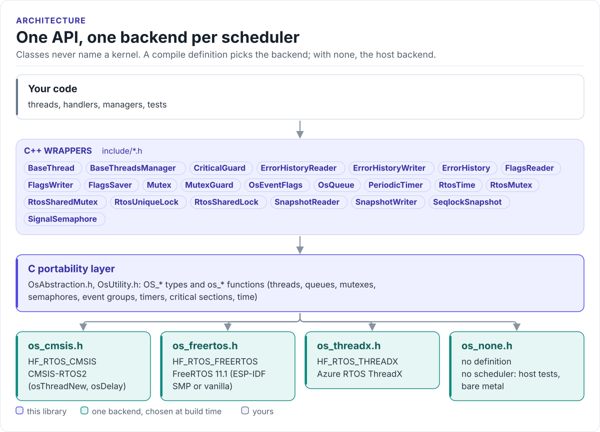

# RTOS Wrapper

C++ classes for threads, mutexes, semaphores, queues, event flags and timers over one portability layer, with
backends for FreeRTOS, ThreadX, CMSIS-RTOS2 and no RTOS at all.

[](https://hardfoc.github.io/hf-utils-rtos-wrap/)
[](LICENSE)

**Documentation: <https://hardfoc.github.io/hf-utils-rtos-wrap/>**

<!-- figure: rtos-layers -->
<picture>
  <source media="(prefers-color-scheme: dark)" srcset="docs/diagrams/rtos-layers.dark.svg">
  
</picture>
<!-- /figure -->

## In 30 seconds

Derive from `BaseThread`, give it a stack, start it:

<!-- generated: quickstart-code -->
```cpp
#include "BaseThread.h"

class BlinkThread : public BaseThread {
public:
    BlinkThread() : BaseThread("Blink") {}

protected:
    bool Initialize() noexcept override {             // creates the task once
        return CreateBaseThread(stack_, sizeof(stack_), /*priority=*/5,
                                /*preempt_threshold=*/5, /*timeSliceAllowed=*/0,
                                OS_AUTO_START);
    }
    bool Setup() noexcept override { on_ = false; return true; }  // on a start
    uint32_t Step() noexcept override {               // the loop body
        on_ = !on_;                                    // toggle an LED here
        return 500;                                    // ms until the next Step()
    }
    bool Cleanup() noexcept override { on_ = false; return true; }  // after a stop
    bool ResetVariables() noexcept override { on_ = false; return true; }

private:
    bool on_ = false;
    uint8_t stack_[4096];                              // no heap: the stack lives here
};

static BlinkThread blink;

bool StartBlink() {
    if (!blink.EnsureInitialized()) {                  // Initialize(): create the task
        return false;
    }
    return blink.StartThreadAndWaitToVerify(/*startTimeoutMsec=*/1000);
}

bool StopBlink() {
    return blink.StopThreadAndWaitToVerify(/*stopTimeoutMsec=*/1000);
}
```
<!-- /generated -->

## What it does

- `BaseThread`: a task that runs `Setup()`, `Step()` in a loop and `Cleanup()`, started and stopped with
  verification.
- `RtosMutex` (works with `std::lock_guard`), `Mutex` and `MutexGuard`, `SignalSemaphore`, `OsEventFlags`,
  `CriticalGuard`.
- `OsQueue<T, N>` and `PeriodicTimer`, with `uint32_t` millisecond timeouts (`UINT32_MAX` waits forever).
- `hf::FlagsSaver`, `hf::SeqlockSnapshot`, `hf::ErrorHistory`: shared state with separate reader and writer
  interfaces.
- One compile definition picks the backend (`HF_RTOS_FREERTOS`, `HF_RTOS_THREADX`, `HF_RTOS_CMSIS`,
  `HF_RTOS_NONE`); component code never names a kernel.
- Host builds can take time from a fake clock (`HF_RTOS_NONE_EXTERNAL_CLOCK`), so timeouts expire in tests.

## Install

```bash
git submodule add https://github.com/hardfoc/hf-utils-rtos-wrap.git external/hf-utils-rtos-wrap
```

```cmake
target_include_directories(my_app PRIVATE external/hf-utils-rtos-wrap/include)
target_sources(my_app PRIVATE external/hf-utils-rtos-wrap/src/RtosMutex.cpp)   # plus the list for your backend
target_compile_definitions(my_app PUBLIC HF_RTOS_FREERTOS=1)
```

Most projects get it through [hf-core](https://github.com/hardfoc/hf-core), which compiles the right sources for
its `HF_CORE_RTOS` setting. The source list per backend is in
[Integration](https://hardfoc.github.io/hf-utils-rtos-wrap/latest/integration/).

## Documentation

| | |
| --- | --- |
| [Quickstart](https://hardfoc.github.io/hf-utils-rtos-wrap/latest/quickstart/) | A worker thread, start to finish |
| [Architecture](https://hardfoc.github.io/hf-utils-rtos-wrap/latest/architecture/) | The layers, the rules, the memory model |
| [Backends](https://hardfoc.github.io/hf-utils-rtos-wrap/latest/backends/) | Selecting a kernel, running without one, adding one |
| [API guide](https://hardfoc.github.io/hf-utils-rtos-wrap/latest/api-guide/) | Which class for which job |
| [Integration](https://hardfoc.github.io/hf-utils-rtos-wrap/latest/integration/) | Sources per backend, compile definitions |
| [API reference](https://hardfoc.github.io/hf-utils-rtos-wrap/latest/api/) | Doxygen |

## Tests

```bash
tools/docs/check-snippets.sh      # the documentation code against the headers; hf-core runs the host tests
```

## License

GPL-3.0; see [LICENSE](LICENSE).
