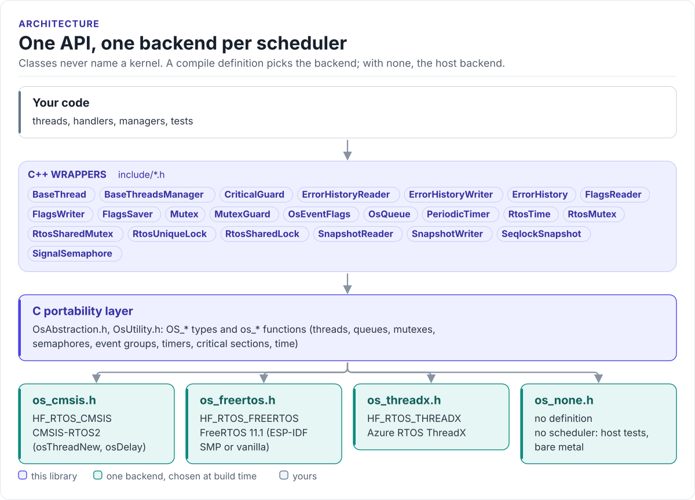
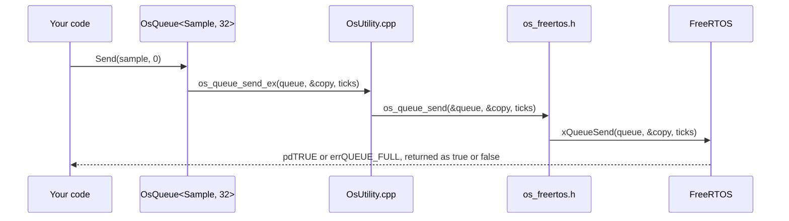

# Architecture

The model the library implements: three layers, and one rule that keeps kernels out of component code.

<!-- figure: rtos-layers -->
<picture>
  <source media="(prefers-color-scheme: dark)" srcset="diagrams/rtos-layers.dark.svg">
  
</picture>
<!-- /figure -->

## Layers

| Layer | Files | Contains |
| --- | --- | --- |
| C++ wrappers | [`include/*.h`](../include/BaseThread.h), [`src/*.cpp`](../src/BaseThread.cpp) | `BaseThread`, `RtosMutex`, `Mutex`, `MutexGuard`, `SignalSemaphore`, `OsQueue`, `OsEventFlags`, `PeriodicTimer`, `CriticalGuard`, the generic templates, `TestLogicWithTimeout` |
| C portability layer | [`include/OsAbstraction.h`](../include/OsAbstraction.h), [`include/OsUtility.h`](../include/OsUtility.h), [`src/OsUtility.cpp`](../src/OsUtility.cpp) | The `OS_*` types and `os_*` functions: threads, queues, mutexes, semaphores, event groups, timers, stream buffers, critical sections, time |
| Backend | [`include/os/`](../include/os/README.md) | One header per scheduler that maps the `OS_*` / `os_*` surface onto the kernel |

## The rules

- **Classes call only the C layer.** No wrapper includes a kernel header; `OsAbstraction.h` is the only header
  that includes a backend.
- **The backend owns every kernel difference**: include layout, core affinity, critical-section style and the tick
  source. A build selects a backend with one definition; it never force-includes a compatibility header or
  redefines a kernel macro.
- **Public surfaces use plain C++ types.** Timeouts are `uint32_t` milliseconds and `UINT32_MAX` waits forever;
  `WaitMode` is an `enum class`. The `OS_Ulong`, `OS_OR` and `OS_WAIT_FOREVER` names stay inside the library.
- **This library is the bottom of the HardFOC dependency chain.** It includes nothing from its sibling or parent
  repositories.

## Memory

Nothing here allocates on a hot path. Allocation happens once, where a kernel object is created:

| Class | When the kernel object is created | Storage you own |
| --- | --- | --- |
| `BaseThread` | `CreateBaseThread()`, from your `Initialize()` | The stack buffer you pass |
| `OsQueue<T, N>` | Constructor | Inline: the kernel queue and `N` word-rounded items (FreeRTOS, ThreadX) |
| `OsEventFlags`, `RtosMutex`, `Mutex`, `SignalSemaphore` | Constructor or first use | None |
| `PeriodicTimer` | `Create()` | None |
| `FlagsSaver`, `SeqlockSnapshot` | Event group on the first wait | Inline words or `T` |
| `ErrorHistory<R, N>` | Its `RtosMutex` | Inline `R[N]` |
| `BaseThreadsManager` | Constructor | `std::map` of threads (heap) |

## One call through the layers

Next: [Backends](backends.md).
