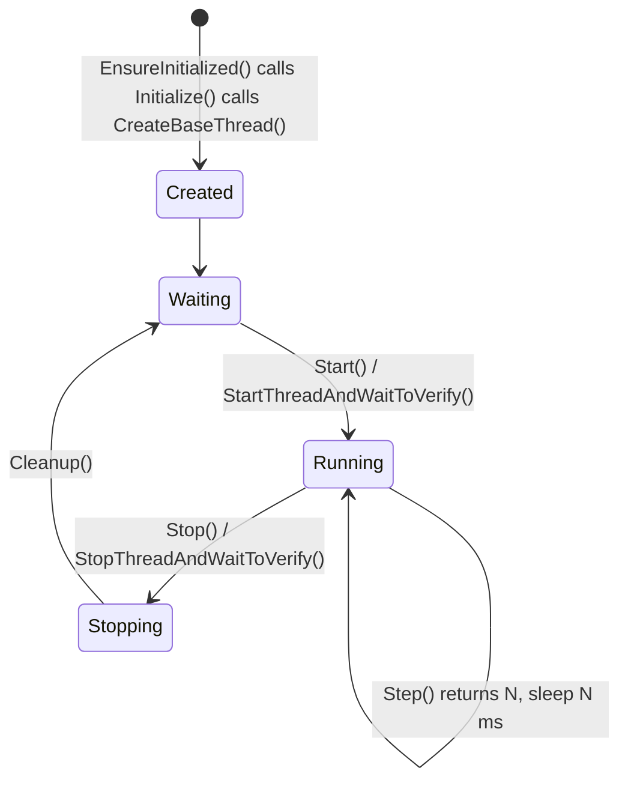

# BaseThread

A worker task with a fixed lifecycle, `Setup()`, `Step()` in a loop, `Cleanup()`, that can be started and stopped
many times and tells you whether a start or stop happened.

## Purpose

Every HardFOC service loop has the same shape: prepare, repeat a step at some rate, tidy up when told to stop.
`BaseThread` owns that loop, the start semaphore and the state flags; you write the five methods that differ.

## Lifecycle



On every start the task calls `ResetVariables()`, then `Setup()` (once per start), then `Step()` until a stop is
requested. After the last `Step()` it calls `Cleanup()` and waits for the next start.

## Example

```cpp
--8<-- "tests/docs/base_thread.cpp:thread"
```

```cpp
--8<-- "tests/docs/base_thread.cpp:start"
```

## Methods you implement

| Method | Access | Called | Return |
| --- | --- | --- | --- |
| `Initialize()` | protected | Once, from `EnsureInitialized()` | True when the task was created; call `CreateBaseThread()` here |
| `ResetVariables()` | protected | At the start of every run | True on success |
| `Setup()` | public | Once per start, before the first `Step()` | True when setup ran |
| `Step()` | public | Repeatedly while running | Milliseconds to sleep before the next `Step()` |
| `Cleanup()` | public | Once per stop, after the last `Step()` | True when cleanup ran |
| `StartAction()` | public, optional | From `Start()`, before the task is signalled | False refuses the start |

## Methods you call

| Method | Blocks | Does |
| --- | --- | --- |
| `EnsureInitialized()` | No | Runs `Initialize()` the first time; returns whether the thread is initialised |
| `Start()` / `Stop()` | No | Signal a start, or request a stop |
| `StartThreadAndWaitToVerify(ms)` | Up to `ms` (default 1000) | Start and wait until the task reports running |
| `StopThreadAndWaitToVerify(ms)` | Up to `ms` | Stop and wait until the task finished `Cleanup()` |
| `Suspend()` / `Resume()` / `IsSuspended()` | No | Kernel suspend and resume of the task |
| `IsThreadRunning()`, `IsSetupComplete()`, `IsCleanupComplete()` | No | State flags |
| `GetStackHighWaterMark()` | No | Minimum free stack seen by the kernel |
| `ChangePriority(p)` | No | Change the task priority |

`CreateBaseThread()` has a second overload with a `core_id` argument that pins the task to a core on SMP kernels
(0 or 1 on the ESP32-S3; a negative value means no affinity). Single-core kernels ignore it.

## Memory and timing

- **No heap in the class.** The stack is a buffer you pass to `CreateBaseThread()`, usually a member array. The
  object also holds a `SignalSemaphore` (with a 40-byte name buffer) and a few flags.
- **The sleep after `Step()` is an `os_delay_msec()`**, which takes a `uint16_t`: return at most 65 535 ms. The
  delay counts from the end of `Step()`, so the period is the step time plus the returned value.
- **A stop takes effect after the current `Step()` and its sleep.** Size the stop timeout to the longest step plus
  sleep.
- **Not copyable.** One object is one kernel task.

## On a host build

With `HF_RTOS_NONE=1`, compile `src/BaseThreadHostStub.cpp` as well. There is no task:
`StartThreadAndWaitToVerify()` runs `Setup()` inline and marks the thread running, and your test calls `Step()`
and applies the returned delay itself. hf-core's host tests do exactly this.

Next: [Synchronization](synchronization.md).
