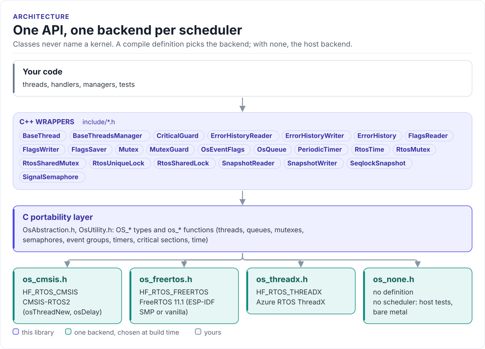

# Figures

<!-- Generated by hardfoc-docs figures from docs/diagrams/figures/*.py. Do not edit by hand. -->

Every figure on this site is drawn by a Python module from facts extracted from the code, so it is rebuilt,
not redrawn, when the code changes. CI runs `hardfoc-docs figures --check` and fails when a
committed figure no longer matches the code. Each figure below lists the files it is drawn from.

## One API, one backend per scheduler

<!-- figure: rtos-layers -->
<picture>
  <source media="(prefers-color-scheme: dark)" srcset="rtos-layers.dark.svg">
  
</picture>
<!-- /figure -->

Figure module: [`docs/diagrams/figures/rtos-layers.py`](../../docs/diagrams/figures/rtos-layers.py)

Drawn from:

- `classes` in [`include/*.h`](../../include/*.h)
- `backend table` in [`include/OsAbstraction.h`](../../include/OsAbstraction.h)
