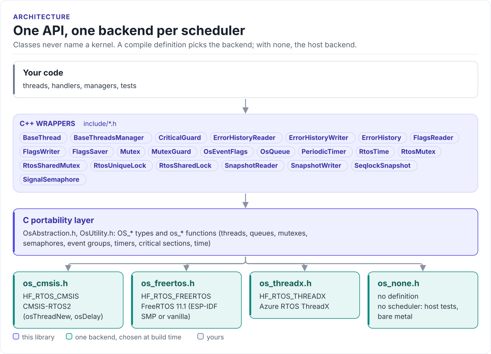

---
hide:
  - navigation
  - toc
---

HardFOC core library

# RTOS Wrapper

C++ classes for threads, mutexes, semaphores, queues, event flags and timers, over one C portability layer
with a backend for FreeRTOS, ThreadX, CMSIS-RTOS2 and no RTOS at all.

[Quickstart](quickstart.md){ .md-button .md-button--primary }
[API guide](api-guide.md){ .md-button }
[Source on GitHub](https://github.com/hardfoc/hf-utils-rtos-wrap){ .md-button }

HardFOC handlers and drivers need to lock, wait, sleep and run worker loops, and they must build for an ESP32 with
FreeRTOS today, an STM32 with ThreadX or CMSIS-RTOS2 later, and a PC for host tests. This library gives them one
API for all of it. Component code includes these headers and never names a kernel; a compile definition picks the
backend.

<!-- figure: rtos-layers -->
<picture>
  <source media="(prefers-color-scheme: dark)" srcset="diagrams/rtos-layers.dark.svg">
  
</picture>
<!-- /figure -->

## What you get

- **Worker threads with a lifecycle.** `BaseThread` runs `Setup()`, then `Step()` in a loop, then `Cleanup()`,
  and can be started and stopped again with verification. See [BaseThread](base-thread.md).
- **Locks that work with the standard library.** `RtosMutex` satisfies `std::lock_guard` and `std::unique_lock`.
  See [Synchronization](synchronization.md).
- **Typed queues and event flags.** `OsQueue<T, N>` with inline storage and `OsEventFlags` with
  `WaitMode::Any` / `WaitMode::All`. Timeouts are `uint32_t` milliseconds; `UINT32_MAX` waits forever. See
  [Queues](queues.md).
- **Shared state without locks.** `hf::FlagsSaver`, `hf::SeqlockSnapshot` and `hf::ErrorHistory`, each split
  into a reader and a writer interface. See [Generic templates](generic-templates.md).
- **Four backends, one contract.** FreeRTOS (ESP-IDF SMP or vanilla), ThreadX, CMSIS-RTOS2 and no RTOS. See
  [Backends](backends.md).
- **Host builds that keep time.** The no-RTOS backend can take its clock and delays from your test harness, so
  timeouts expire without real waiting. See [Backends](backends.md#time-without-a-scheduler).

## Used by

| Repository | Uses |
| --- | --- |
| [hf-core-utils](https://github.com/hardfoc/hf-core-utils) | Carries this library as a submodule next to hf-utils-general and hf-utils-canopen |
| [hf-core](https://github.com/hardfoc/hf-core) | `RtosMutex` in the handlers, `PeriodicTimer`, and `BaseThread` with the no-RTOS backend in the host build |

## Where to go next

-   :material-rocket-launch-outline: **[Quickstart](quickstart.md)**

    ---

    A worker thread in 30 lines.

-   :material-layers-outline: **[Architecture](architecture.md)**

    ---

    The three layers and the rules between them.

-   :material-swap-horizontal: **[Backends](backends.md)**

    ---

    Select a kernel, run without one, add one.

